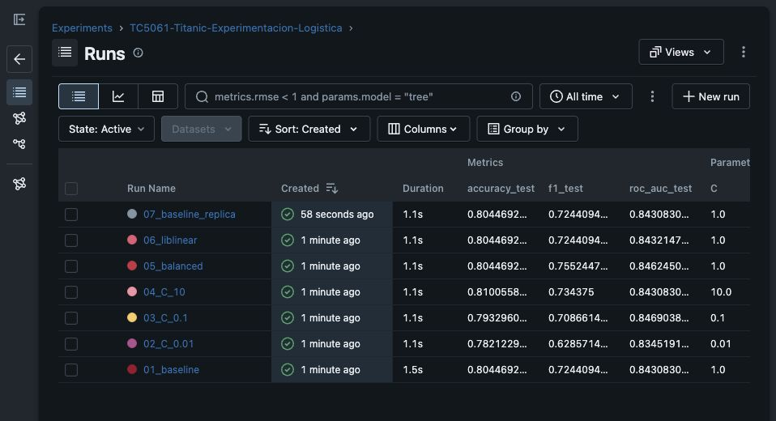
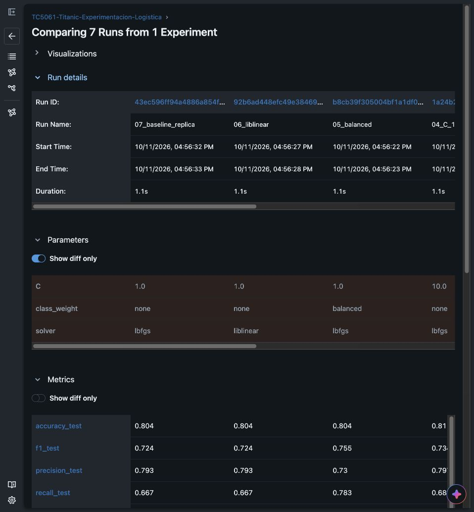
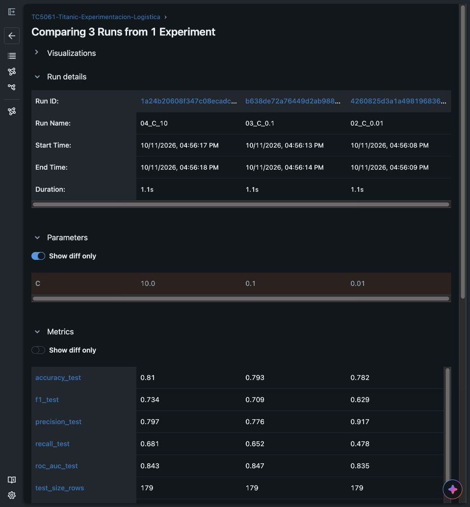
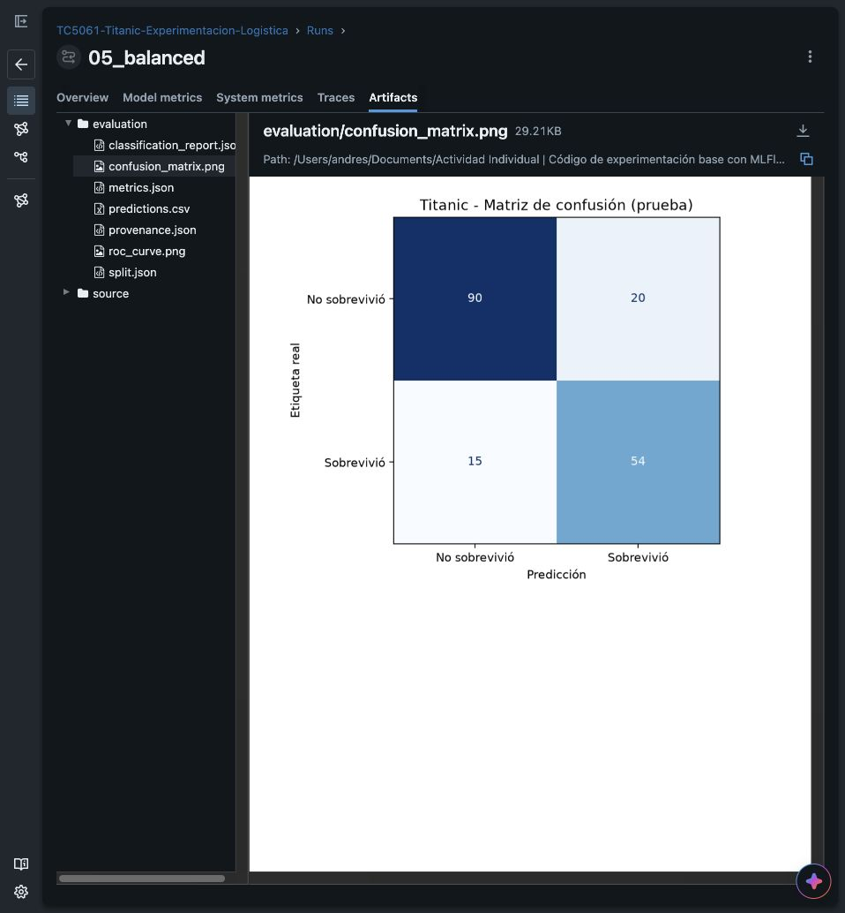

# Experimentación con MLflow

**Alumno:** José Andrés Hernández Guerra  
**Matrícula:** A01840564  
**Materia:** TC5061  
**Fecha:** 11 de octubre de 2026  
**Repositorio de GitHub:** [Ver repositorio en GitHub](https://github.com/a01840564/Actividad-Individual-C-digo-de-experimentaci-n-base-con-MLFlow)

## Análisis de resultados

En esta actividad pasé el modelo de Titanic del notebook a un archivo de Python. Así puedo cambiar sus parámetros desde la terminal y guardar los resultados en MLflow. Conservé la regresión logística del trabajo anterior. Probé seis configuraciones y repetí la base para revisar que diera el mismo resultado.

**Datos utilizados:**  
Total de pasajeros: 891  
Para entrenar: 712  
Para evaluar: 179

Elegí el modelo con el mejor F1 porque me interesaba identificar bien a los sobrevivientes. No me basé solo en el porcentaje de aciertos, ya que en los datos hay más personas que no sobrevivieron.

**Configuración elegida:** `C=1`, `class_weight=balanced`, `solver=lbfgs`.  
F1: **0.7552**  
Accuracy: **0.8045**, cerca del 80 % de aciertos  
ROC-AUC: **0.8462**

El F1 de la base fue 0.7244. Al usar `balanced`, el modelo encontró a más sobrevivientes, aunque también cometió más errores al decir que alguien sobrevivió. Identificó correctamente a 54 de los 69 sobrevivientes.

El parámetro que más cambió los resultados fue `C`. En esas pruebas, el F1 fue de 0.6286 a 0.7344. Con `C=0.01`, el modelo tuvo más dificultad para reconocer a los sobrevivientes. Cambiar a `liblinear` no mejoró el F1 ni la accuracy. `C=10` tuvo la mayor accuracy, pero elegí `balanced` por su mejor F1.

La repetición de la base dio los mismos resultados. También corregí el cálculo usado para limitar los valores altos de `Fare`, que es el precio del boleto. Ahora se calcula solo con los datos de entrenamiento.

Una limitación es que usé pocos datos y una sola división para comparar los modelos. Por eso no puedo asegurar que el ganador funcione igual con datos nuevos. Después probaría varias divisiones y dejaría datos aparte para una evaluación final.

<div style="page-break-after: always"></div>

## Cómo ejecutar el proyecto

Dejé el notebook para revisar los datos. El archivo `train.py` prepara los datos, entrena el modelo y calcula sus resultados. Los comandos se escriben desde la carpeta del proyecto, con el entorno de Python activado.

Para repetir las siete corridas:

```bash
python run_experiments.py
```

El comando utilizado para la configuración ganadora fue:

```bash
python train.py --C 1.0 --class-weight balanced --solver lbfgs --seed 42 --run-name 05_balanced
```

También se puede ejecutar `python train.py` sin argumentos para entrenar la base. Para ver los resultados en MLflow:

```bash
mlflow ui --backend-store-uri sqlite:///mlflow.db --host 127.0.0.1 --port 5000
```

Después se abre esta dirección en el navegador:

`http://127.0.0.1:5000`

El experimento se llama **TC5061-Titanic-Experimentacion-Logistica**. Para comparar los resultados, se seleccionan las corridas y se presiona **Compare**.

## Resultados de las corridas

| Corrida | C | class_weight | solver | Accuracy | F1 | ROC-AUC |
| --- | ---: | --- | --- | ---: | ---: | ---: |
| 01_base | 1 | none | lbfgs | 0.8045 | 0.7244 | 0.8431 |
| 02_C_0.01 | 0.01 | none | lbfgs | 0.7821 | 0.6286 | 0.8345 |
| 03_C_0.1 | 0.1 | none | lbfgs | 0.7933 | 0.7087 | 0.8469 |
| 04_C_10 | 10 | none | lbfgs | 0.8101 | 0.7344 | 0.8431 |
| **05_balanced** | **1** | **balanced** | **lbfgs** | **0.8045** | **0.7552** | **0.8462** |
| 06_liblinear | 1 | none | liblinear | 0.8045 | 0.7244 | 0.8432 |
| 07_réplica_base | 1 | none | lbfgs | 0.8045 | 0.7244 | 0.8431 |

La última corrida repite la base. La usé para comprobar que los resultados fueran iguales.

## Cómo repetir los resultados

Usé la semilla **42** para mantener la misma división de los datos y repetir el entrenamiento. La preparación de los datos se ajusta solo con la parte usada para entrenar.

Las versiones utilizadas y los datos del modelo guardado están en el anexo.

<div style="page-break-after: always"></div>

## Evidencias de MLflow

### 1. Tabla de las siete corridas

Aquí se ven las siete corridas y sus resultados.



<div style="page-break-after: always"></div>

### 2. Vista de comparación

Seleccioné las siete corridas en **Compare Runs**. En esta parte se ven la repetición de la base, la prueba con `liblinear` y la prueba con `balanced`.



<div style="page-break-after: always"></div>

### 3. Comparación de los valores de C

Aquí comparé tres valores de `C`. Dejé los demás parámetros iguales para ver qué tanto cambiaban los resultados.



<div style="page-break-after: always"></div>

### 4. Detalle de la corrida y sus artefactos

**Corrida elegida:** `05_balanced`  
**ID:** `b8cb39f305004bf1a1df0c6a5b8fed1f`

En **Artifacts** están las gráficas, los resultados y las predicciones. La matriz de confusión muestra los aciertos y los errores del modelo. El modelo guardado se encuentra en **Models**.



<div style="page-break-after: always"></div>

## Anexo. Versiones y modelo guardado

**Versiones utilizadas:**  
Python: 3.14.7  
MLflow: 3.17.0  
scikit-learn: 1.9.1  
NumPy: 2.5.4  
pandas: 3.0.6  
matplotlib: 3.11.2

Las versiones están guardadas en `requirements.txt` y `requirements-lock.txt`. El README explica cómo instalarlas.

MLflow guarda los parámetros, resultados, gráficas y el modelo de cada corrida. Git guarda las versiones del código. El modelo elegido quedó registrado con estos datos:

Nombre: **TC5061-Titanic-RegresionLogistica**  
Versión: **1**  
Alias: `candidate`

También comprobé que el modelo guardado diera las mismas predicciones al cargarlo de nuevo.
